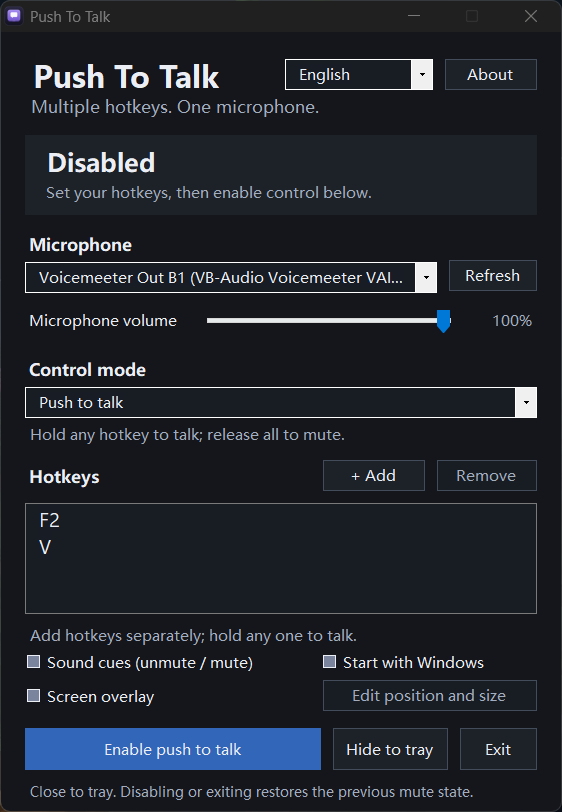

# Push To Talk

English | [简体中文](README.zh-CN.md)

**Multiple hotkeys. One microphone.**

A lightweight, portable Windows app that lets you control a microphone with multiple keyboard or mouse shortcuts.

**Version 1.1** · Windows 10 / 11 · .NET Framework 4.x



## Features

- **Multiple hotkeys** — bind individual keys, key combinations, or mouse buttons. Hold any assigned shortcut to talk; release all to mute.
- **Three control modes** — push to talk, push to mute, and toggle on / off.
- **Dark interface with two languages** — English and Simplified Chinese, following your Windows display language by default.
- **Optional sound cues** — distinct sounds for unmuting and muting.
- **Editable screen overlay** — microphone status icons with adjustable position, size, and opacity.
- **System tray and startup support** — start as administrator at sign-in; after approval, automatically enable control when saved hotkeys and the selected microphone are available.

Hotkeys start empty. Sound cues, the screen overlay, and startup are off by default.

## Quick start

1. Extract the portable package into a writable folder, keep both `.exe` files together with their original names, and run `Push To Talk.exe`.
2. Select your microphone and choose **Add hotkey**. Add each shortcut separately.
3. Select **Push to talk**, then click **Enable push to talk**.
4. Hold any assigned shortcut to talk. Closing the window keeps the app running in the tray; choose **Exit** to quit.

Administrator permission is required. Approve the Windows UAC prompt when launching, including at sign-in if startup is enabled. Cancelling the prompt leaves the app closed.

Settings are saved beside the app in `settings.xml`. The app controls the selected microphone's Windows mute state and restores it when control is disabled or the app exits normally. Audio stays local; the app does not record or upload your voice.

## Build

Run in PowerShell with .NET Framework 4.x installed:

```powershell
.\build.ps1
```

Output: `bin\Push To Talk.exe` and `bin\Push To Talk Startup.exe`. To run the tests:

```powershell
.\test.ps1
```

## Author & license

Created by [AeXiaohu](https://github.com/AeXiaohu). Licensed under the [MIT License](LICENSE.txt).
