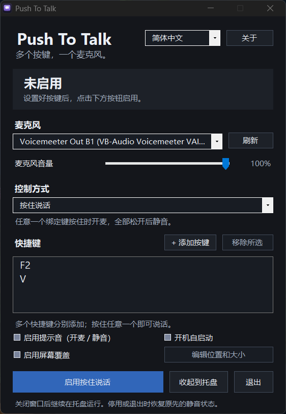

# Push To Talk

[English](README.md) | 简体中文

轻量、便携的 Windows 麦克风快捷键工具。多个快捷键控制同一个麦克风，按住任意一个即可说话，全部松开后静音。

**版本 1.2 · Windows 10 / 11 · 无需安装**



## 功能

- 支持多个键盘、鼠标侧键快捷键及组合键。
- 提供按住说话、按住静音、按一下切换三种模式。
- 可调整当前所选麦克风的 Windows 输入音量，范围 0–100%，与静音控制独立。
- 暗黑界面，支持系统托盘后台运行。
- 中英文即时切换，默认跟随系统语言。
- 可选开麦 / 静音提示音，默认关闭。
- 可选管理员开机自启动，默认关闭；确认授权后，已有快捷键且麦克风可用时自动启用控制。
- 可选屏幕覆盖，默认关闭；显示开麦 / 静音状态，可拖动调整位置、大小，并设置不透明度。

设置保存在程序旁的 `settings.xml`。静音和音量调整会影响使用所选麦克风的其他应用；停用或正常退出时恢复此前的静音状态。所有声音处理均在本地，不录制或上传语音。

## 快速开始

1. 打开 `Push To Talk.exe`，选择麦克风。
2. 点击“添加按键”，分别添加需要的快捷键，例如 `F2` 和 `MouseX1`。
3. 选择“按住说话”，点击“启用按住说话”。首次打开没有默认快捷键。
4. 关闭主窗口可收起到托盘，右键托盘可停用或退出。

软件仅需一个可执行文件。手动启动或启用自启动后的登录启动，会先通过 Windows UAC 请求管理员权限，确认后才进入主界面；取消授权则不启动软件。

按住说话时，同时按住多个快捷键，需要全部松开才会静音。

## 从源码构建

需要 Windows 和 .NET Framework 4.x，无需下载 NuGet 包。在项目根目录运行：

```powershell
.\build.ps1
```

生成程序：`bin\Push To Talk.exe`。运行测试：

```powershell
.\test.ps1
```

## 作者与许可证

[AeXiaohu](https://github.com/AeXiaohu) · [MIT License](LICENSE.txt)
